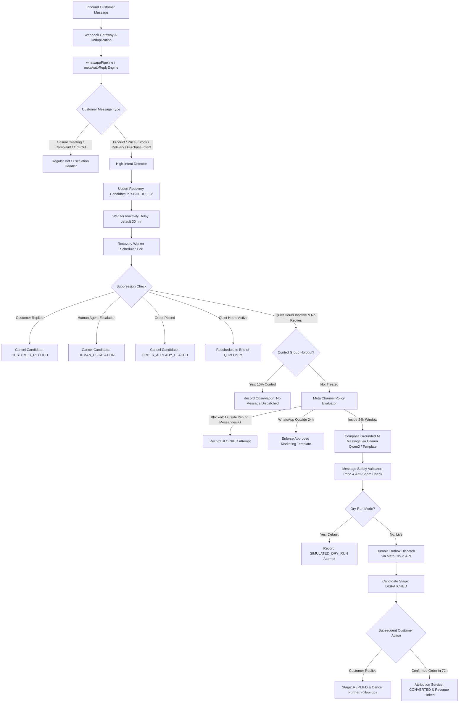

# KreazyAI — Smart Sales Recovery Agent Architecture & Specification

## 1. System Overview
The **Smart Sales Recovery Agent** detects high buying-intent shopper inquiries across business messaging channels (WhatsApp, Facebook Messenger, Instagram Direct), observes when the customer has gone silent after receiving an answer, waits for a tenant-configured inactivity window (default: 30 minutes), enforces Meta 24-hour service policies, composes a grounded anti-hallucinatory recovery message, and attributes subsequent confirmed orders without double-counting or inventing revenue.

---

## 2. Implemented Database Schema (SQLite WAL Mode)

### `recovery_settings`
- `id` (TEXT PRIMARY KEY)
- `tenant_id` (TEXT UNIQUE REFERENCES businesses(id))
- `enabled` (INTEGER DEFAULT 0) — Master kill switch (default: OFF)
- `dry_run` (INTEGER DEFAULT 1) — Safety simulation (default: ON)
- `channels` (TEXT JSON: `{"whatsapp":true,"messenger":false,"instagram":false}`)
- `min_intent_score` (REAL DEFAULT 0.70)
- `inactivity_minutes` (INTEGER DEFAULT 30)
- `quiet_hours_enabled` (INTEGER DEFAULT 1)
- `quiet_hours_start` (TEXT DEFAULT '22:00')
- `quiet_hours_end` (TEXT DEFAULT '08:00')
- `timezone` (TEXT DEFAULT 'Asia/Dhaka')
- `max_daily_attempts_per_lead` (INTEGER DEFAULT 2)
- `max_daily_tenant_attempts` (INTEGER DEFAULT 100)
- `consent_policy` (TEXT DEFAULT 'EXPLICIT_OR_24H')
- `model_provider` (TEXT DEFAULT 'local_ollama')
- `model_name` (TEXT DEFAULT 'qwen3:1.7b')
- `control_group_ratio` (REAL DEFAULT 0.10) — 10% scientific holdout

### `recovery_candidates`
- `id` (TEXT PRIMARY KEY)
- `tenant_id` (TEXT NOT NULL REFERENCES businesses(id))
- `conversation_id` (TEXT NOT NULL REFERENCES conversations(id))
- `channel` (TEXT DEFAULT 'WHATSAPP')
- `customer_id` (TEXT REFERENCES customers(id))
- `intent_score` (REAL NOT NULL)
- `intent_category` (TEXT NOT NULL)
- `intent_reason` (TEXT)
- `buying_signals` (TEXT JSON array)
- `product_identifiers` (TEXT JSON array)
- `detected_language` (TEXT DEFAULT 'en')
- `last_customer_message_text` (TEXT)
- `last_customer_message_at` (TEXT NOT NULL)
- `eligible_at` (TEXT NOT NULL)
- `stage` (TEXT: IDENTIFIED, SCHEDULED, DISPATCHED, REPLIED, CONVERTED, EXPIRED, CANCELLED)
- `state` (TEXT: PENDING, PROCESSING, COMPLETED, FAILED)
- `version` (INTEGER DEFAULT 1) — Optimistic concurrency locking
- `is_control_group` (INTEGER DEFAULT 0)
- `deduplication_key` (TEXT UNIQUE NOT NULL)

### `recovery_attempts`
- `id` (TEXT PRIMARY KEY)
- `tenant_id` (TEXT NOT NULL REFERENCES businesses(id))
- `candidate_id` (TEXT NOT NULL REFERENCES recovery_candidates(id))
- `channel` (TEXT NOT NULL)
- `scheduled_at`, `attempted_at` (TEXT)
- `outcome` (TEXT: PENDING, DELIVERED, SIMULATED_DRY_RUN, BLOCKED, FAILED)
- `failure_reason` (TEXT)
- `policy_check_result` (TEXT JSON)
- `generation_model` (TEXT)
- `prompt_tokens`, `completion_tokens`, `latency_ms`, `cost_estimate` (NUMERIC)
- `message_text`, `message_hash`, `provider_response_id` (TEXT)

### `recovery_events`
- `id` (TEXT PRIMARY KEY)
- `tenant_id` (TEXT NOT NULL REFERENCES businesses(id))
- `candidate_id` (TEXT REFERENCES recovery_candidates(id))
- `attempt_id` (TEXT REFERENCES recovery_attempts(id))
- `event_type` (TEXT: INTENT_DETECTED, SCHEDULED, RESCHEDULED, POLICY_CHECK_PASSED, POLICY_CHECK_BLOCKED, MESSAGE_DISPATCHED, CUSTOMER_REPLIED, ORDER_ATTRIBUTED, CANCELLED)
- `event_at` (TEXT DEFAULT datetime('now'))
- `metadata` (TEXT JSON)

### `recovery_attributions`
- `id` (TEXT PRIMARY KEY)
- `tenant_id` (TEXT NOT NULL REFERENCES businesses(id))
- `candidate_id` (TEXT NOT NULL REFERENCES recovery_candidates(id))
- `attempt_id` (TEXT REFERENCES recovery_attempts(id))
- `order_id` (TEXT NOT NULL REFERENCES orders(id))
- `order_value` (REAL NOT NULL)
- `currency` (TEXT DEFAULT 'USD')
- `attributed_at` (TEXT DEFAULT datetime('now'))
- `attribution_method` (TEXT DEFAULT 'LAST_TOUCH')
- `is_control_group` (INTEGER DEFAULT 0)
- `UNIQUE(tenant_id, order_id)` — Guarantees zero duplicate revenue counting

### `recovery_outbox`
- `id` (TEXT PRIMARY KEY)
- `tenant_id` (TEXT NOT NULL REFERENCES businesses(id))
- `candidate_id` (TEXT NOT NULL REFERENCES recovery_candidates(id))
- `attempt_id` (TEXT REFERENCES recovery_attempts(id))
- `channel`, `recipient`, `status` ('QUEUED', 'SENDING', 'SENT', 'FAILED', 'CANCELLED')
- `idempotency_key` (TEXT UNIQUE NOT NULL)
- `payload` (TEXT NOT NULL)
- `retries`, `max_retries`, `next_retry_at`

---

## 3. High-Intent Detection Architecture
To minimize AI inference latency and avoid external API expenses, lead recognition uses a **deterministic-first, LLM-second pipeline**:
1. **Sanitization & Prompt Injection Defense**: Strips ASCII control characters, disarms system instruction escapes (`ignore all previous instructions`), and bounds input to 1,000 characters.
2. **Exclusions**:
   - Explicit opt-outs (`STOP`, `unsubscribe`, `block`)
   - Human escalation requests (`talk to human`, `agent please`, `manush`)
   - Complaints and refund demands (`damaged`, `broken`, `fraud`, `scam`)
   - Casual greetings without product mentions (`hi`, `hello`, `assalamu alaikum`, `kemon achen`)
3. **Unicode-Aware Buying Signal Matchers**:
   - **Direct Purchase Intent**: `buy`, `order`, `অর্ডার করতে চাই`, `order korte chai`, `nite chai`, `কিনতে চাই`
   - **Pricing & Discounts**: `price`, `cost`, `how much`, `দাম কত`, `টাকা`, `price koto`, `discount`
   - **Catalog Availability**: `in stock`, `available`, `স্টকে আছে`, `পাওয়া যাবে`, `stock e ache`
   - **Size / Color Specifications**: `size M`, `size Large`, `black color`, `সাইজ`, `কালার`
   - **Delivery Charges**: `delivery fee`, `কুরিয়ার চার্জ`, `ডেলিভারি চার্জ`, `how many days`
4. **Structured Schema Validation**: When deterministic heuristics cannot reach high confidence, local Ollama Qwen3 is invoked with strict JSON runtime schema validation.

---

## 4. Meta Platform Policy Compliance
The `recoveryPolicyService` acts as a zero-trust policy gate before any message is sent:
- **WhatsApp**:
  - Within 24 hours of customer's last message: Free-form conversational messaging permitted.
  - Outside 24 hours: Free-form text strictly blocked. Requires Meta-approved marketing template (`sales_recovery_followup`) and verified opt-in.
- **Facebook Messenger & Instagram Direct**:
  - Within 24 hours: Standard messaging permitted.
  - Outside 24 hours: Proactive marketing is prohibited by Meta Platform terms. Message tags (`HUMAN_AGENT`, `CONFIRMED_EVENT_UPDATE`) cannot be used for sales follow-ups. Blocked automatically.
- Every policy decision (permitted or blocked) is written to `recovery_events` with detailed rationale.

---

## 5. Anti-Hallucination & AI Safety Engine
- Grounded strictly in the live tenant-scoped catalog from `products` table (`SELECT * FROM products WHERE (business_id = ? OR tenant_id = ?)`).
- Cross-tenant catalog data leakage is impossible.
- **Message Safety Validator**:
  - Validates any quoted numeric price against the database catalog price. If the model hallucinates a different price, the message is discarded.
  - Enforces max discount policy.
  - Rejects banned aggressive phrases (`HURRY UP`, `BUY NOW OR CRY`).
  - Falls back gracefully to pre-approved deterministic templates in Bengali, Banglish, or English.

---

## 6. Order Attribution & Incrementality
- Linked directly upon order creation in `orderController.create` via `recoveryAttributionService.attributeOrder`.
- Deduplication: `UNIQUE(tenant_id, order_id)` in SQLite prevents double attribution for webhook retries or status updates.
- 10% A/B Holdout Group: Tracks organic conversion baseline against treated conversion to report true incremental lift.
