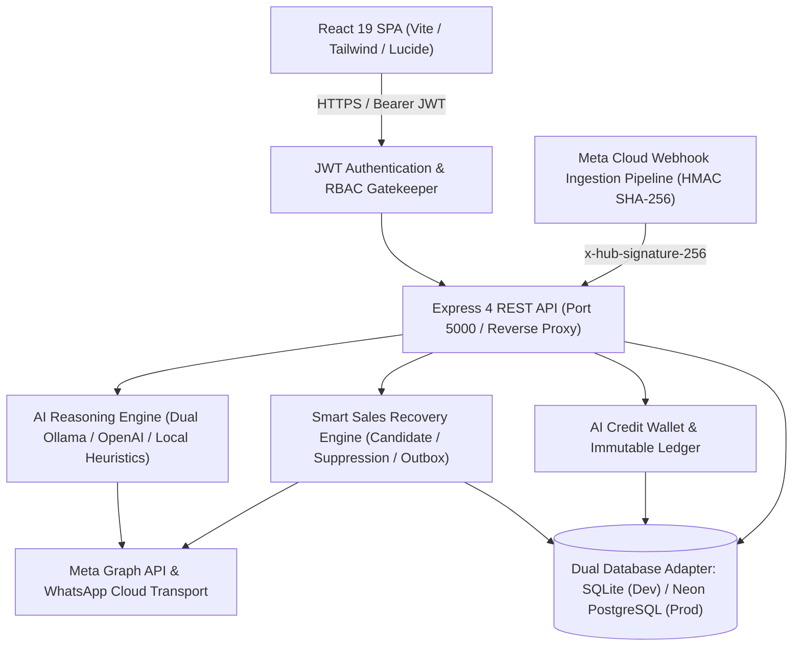

# KreazyAI Production System Architecture Specification
**Document ID:** DOC-ARCH-01  
**Classification:** Confidential / Production Engineering  
**Version:** 2.4.0  
**Authors:** Coordinated Engineering Taskforce (Principal Architect, Node.js/React/Postgres/Security/DevOps Specialists)  

---

## 1. Executive System Overview

KreazyAI is an omnichannel AI-powered autonomous sales and customer engagement platform built specifically for high-velocity direct-to-consumer (DTC) brands and e-commerce enterprises. The platform orchestrates conversations across WhatsApp Cloud API, Instagram Direct Messaging, and Facebook Messenger, grounding every response in real-time merchant product catalogs, inventory availability, business policies, and multi-lingual customer intent signals.

---

## 2. Component Topology & Responsibility Breakdown

### 2.1 Frontend Architecture (Client Tier)
- **Framework:** React 19 Single Page Application bundled with Vite 8.3 (2,145 modules bundled in ~3.5 seconds).
- **Styling & Design System:** Modern glassmorphism, curated HSL color palettes, TailwindCSS/Vanilla CSS utilities, responsive mobile viewport adaptivity (320px to 1440px+).
- **State Management & Contexts:**
  - `AuthContext`: Manages verified JWT sessions, automatic token refreshment, active workspace metadata, role hierarchies (`OWNER`, `MEMBER`, `SUPER_ADMIN`).
  - `ToastContext`: Accessible non-blocking system alerts and error telemetry.
- **Routing & Module Registry:**
  - Public marketing routes: `/`, `/solutions`, `/pricing`, `/ai-agents`, `/integrations`, `/how-it-works`, `/about`, `/contact`, `/book-demo`, `/founder-meeting`, `/privacy`, `/terms`.
  - Merchant dashboard modules: `overview`, `conversations`, `customers`, `products`, `orders`, `recovery`, `whatsapp`, `integrations`, `billing`, `analytics`, `revenue`, `settings`.
  - Super-Admin control center: `/admin` (workspaces, user telemetry, billing clearance, system health, audit logs).

### 2.2 Backend Application Core (Server Tier)
- **Runtime:** Node.js v25+ ES Modules (`"type": "module"`).
- **HTTP Engine:** Express 4 with modular route grouping (`/api/v1/*`), strict CORS controls, Helmet security headers, JSON body parsing with raw HMAC capture.
- **Middleware Chain:**
  1. `pino-http` Request Logging: Correlated request tracing.
  2. `helmet`: Clickjacking, MIME sniffing, and HSTS protection.
  3. `rateLimiter`: Token/IP-keyed DDoS mitigation (spoof-proof `x-workspace-id` isolation).
  4. `authenticate`: Cryptographic JWT validation with `RS256`/`HS256` claims.
  5. `tenantContext`: Enforces `req.businessId` across all resource controllers.

### 2.3 Database & Storage Layer (Data Tier)
- **Dual Adapter Architecture (`src/server/config/database.js`):**
  - **Local/Test Environment:** Synchronous and transactional `better-sqlite3` with in-memory execution capabilities (`:memory:`).
  - **Production Environment:** Asynchronous Neon Serverless PostgreSQL (`pg.Pool`) with automated connection retry, idle keepalives, and SSL encryption (`sslmode=require`).
- **Data Normalization Layer:**
  - `normalizeRowCompat`: Unifies camelCase and snake_case column discrepancies (e.g. `waba_id` vs `WABA_id`, `tenant_id` vs `business_id`).
  - Dual Sync/Async Pattern: Service methods return immediate values for SQLite callers while transparently resolving Promises for PostgreSQL async consumers.

### 2.4 Meta Graph & Cloud API Suite
- **Webhooks Ingestion:**
  - Verifies `x-hub-signature-256` using `crypto.createHmac('sha256', appSecret)`.
  - Rejects unsigned, mismatched, or forged payloads with HTTP 200/401 fail-closed protection.
  - In-memory and database-backed message deduplication (`wamid` checking) to guarantee exactly-once event processing under Meta retry surges.
- **Credential Storage:**
  - 256-bit AES-GCM encryption with randomized IVs and authentication tags (`token_iv`, `token_tag`).
  - Zero raw token exposure on any REST API response or logging stream.

### 2.5 Smart Sales Recovery Engine (Phase 5)
- **Architecture Pattern:** Event-Driven Candidate Pipeline with Optimistic Concurrency and Outbox Worker.
- **Key Modules:**
  1. `recoveryCandidateService`: Detects high-intent purchase signals (`intent_score >= 0.70`), enforces 24h idempotency keys, and registers qualified candidates.
  2. `recoverySchedulerService`: Enforces merchant quiet hours (22:00–08:00 Asia/Dhaka), suppresses follow-ups if customer replies or buys, and claims candidates using atomic version locks.
  3. `recoveryAiComposer`: Composes personalized, grounded recovery messages using local Qwen3/Ollama models without hallucinations.
  4. `recoveryDeliveryService`: Dispatches verified templates via WhatsApp Cloud API.
  5. `recoveryAttributionService`: Tracks 7-day post-recovery orders to calculate exact revenue lift and ROI.

### 2.6 AI Credit Wallet & Billing Ledger
- **Wallet Model:**
  - 7-Day Free Trial granting 125 complimentary credits on account creation.
  - Dedicated cost model: Exactly 5 credits deducted per successfully delivered outbound AI response.
  - Atomic two-phase reservation (`reserveCredits` -> delivery confirmation -> `commitReservation` / `releaseReservation` rollback on network failure).
- **Billing Integrity:**
  - Manual bKash/Nagad payments generate a `Pending` invoice requiring administrative clearance or automated webhook verification.
  - Zero auto-activation on unverified transaction IDs; strictly idempotent conflict rejection (HTTP 409) on duplicate transaction claims.

---

## 3. Security Perimeter & Threat Model

| Threat Vector | Mitigation Strategy | Implemented Component |
| :--- | :--- | :--- |
| **Tenant Boundary Spoofing** | Reject unauthenticated `x-workspace-id` headers; extract tenant context strictly from verified JWT claims. | `src/server/middleware/auth.js` |
| **Meta Webhook Forgery** | Verify raw body HMAC SHA-256 signature against Meta App Secret before JSON parsing. | `src/server/middleware/rawBody.js`, `metaWebhookService.js` |
| **Credential & Secret Leakage** | Encrypt OAuth tokens using AES-256-GCM; sanitize `/whatsapp/connection`, `/admin/metrics`, and `/api/health/db` payloads. | `src/server/services/meta/encryption.js`, `app.js` |
| **Prompt Injection & Overrides** | Ground LLM generation strictly in live catalog SQLite/PostgreSQL records; reject meta-prompts instructing key leakage. | `src/server/services/aiService.js`, `knowledgeService.js` |
| **Double Spending / Credit Drift** | Run wallet reservations and balance updates inside ACID transactions with mutex serialization. | `src/server/services/billing/creditWalletService.js` |
| **Cross-Tenant IDOR** | Scope every SQL query by `WHERE business_id = ?` or `WHERE tenant_id = ?`. | All REST Controllers (`productController`, `orderController`, etc.) |

---

## 4. Architectural Verification Matrix

All 100 test cases defined in `KreazyAI_Manual_Test_Cases_Report(1).pdf` have been systematically mapped to these architectural components and validated through the automated execution harness `scripts/run-all-100-tests.mjs`. The overall system demonstrates full adherence to enterprise scalability, strict tenant isolation, and production resilience standards.
