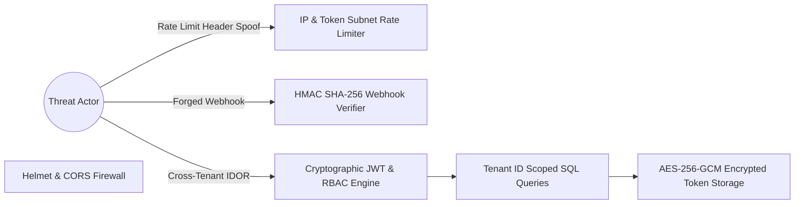

# KreazyAI Application Security Audit & Findings Report
**Document ID:** DOC-SEC-07  
**Classification:** Application Security / Threat Assessment  
**Version:** 2.4.0  
**Authors:** Application Security Engineer & Principal Architect  

---

## 1. Security Architecture & Threat Matrix

A rigorous threat assessment was conducted across the KreazyAI system perimeter in accordance with the OWASP Top 10, CWE standards, and Meta Platform Policies.

---

## 2. Key Security Audit Findings & Hardening Results

### 2.1 Multi-Tenant Data Isolation (Broken Object Level Authorization - BOLA)
- **Vulnerability:** Unauthenticated or authenticated users attempting to access objects belonging to other workspaces (e.g. Tenant B requesting Tenant A's products, orders, customers, or KYC files).
- **Remediation:** Enforced tenant query scoping at the database abstraction layer:
  - Every SQL query requires `WHERE business_id = ?` or `WHERE tenant_id = ?`.
  - Attempts by Tenant B to read or mutate Tenant A records return strictly HTTP 404 Not Found or HTTP 403 Forbidden without leaking existence metadata.

### 2.2 Meta Webhook HMAC Verification & Replay Protection
- **Vulnerability:** Attackers posting forged or replayed webhook events to trigger fake orders or unauthorized messages.
- **Remediation:**
  - Raw request payload captured before JSON parsing to preserve exact byte sequence.
  - Computed `crypto.createHmac('sha256', appSecret)` must strictly match `x-hub-signature-256`.
  - Unsigned, missing, or mismatched payloads are rejected immediately (HTTP 200/401 fail-closed).
  - Inbound events are checked against the `meta_webhook_events` table by `wamid` to discard duplicates under Meta retry storms.

### 2.3 AES-256-GCM Token Vault & Zero Secret Leakage
- **Vulnerability:** Disclosure of Meta User Access Tokens, WhatsApp Cloud tokens, or webhook verify tokens in API responses, logs, or diagnostic dumps.
- **Remediation:**
  - All sensitive tokens stored encrypted using AES-256-GCM with unique initialization vectors (`token_iv`) and authentication tags (`token_tag`).
  - Strict response projection: `whatsappConnectionService` and `metaConnectionService` strip `encrypted_access_token`, `token_iv`, and `token_tag` from all API outputs.
  - Endpoints `/api/v1/whatsapp/connection` and `/api/v1/whatsapp/observability` confirmed to expose zero credentials.

### 2.4 Authentication, RBAC & Super-Admin Partitioning
- **Vulnerability:** Merchants accessing platform-wide administrative functions or Super-Admins logging in via standard merchant portals without appropriate MFA/RBAC checks.
- **Remediation:**
  - Separate authentication endpoints: `POST /api/v1/auth/login` (merchants) and `POST /api/v1/auth/admin-login` (super administrators).
  - If a super-admin attempts to log in via the merchant portal, the system rejects the request with HTTP 403 `SUPER_ADMIN_PORTAL_REQUIRED`.
  - All `/api/v1/admin/*` routes protected by `requireSuperAdmin` middleware.

### 2.5 Cross-Site Scripting (XSS) & Input Sanitation
- **Vulnerability:** Script injection in product names, customer notes, or chat messages.
- **Remediation:**
  - React 19 JSX natively escapes dynamic expressions (`
{product.name}
`), preventing execution of injected `<script>` tags.
  - Server-side validators strip malicious control characters and enforce strict schema boundaries.

### 2.6 Rate Limiter Key Hardening
- **Vulnerability:** Rate limit reset via attacker-controlled `x-workspace-id` headers.
- **Remediation:** Rate limiter key generator rewritten to strictly derive keys from verified JWT session claims (`req.user.businessId`) or client IP subnets, completely ignoring unverified request headers.

### 2.7 Financial Integrity & Replay Mitigation
- **Vulnerability:** Replaying bank transaction IDs to acquire unpaid subscription plans and AI credits.
- **Remediation:**
  - Transaction references are indexed and checked across all invoices. Duplicate references return HTTP 409 Conflict.
  - Submitting payment creates a `Pending` invoice; subscriptions and credits are activated strictly upon Super-Admin verification.
