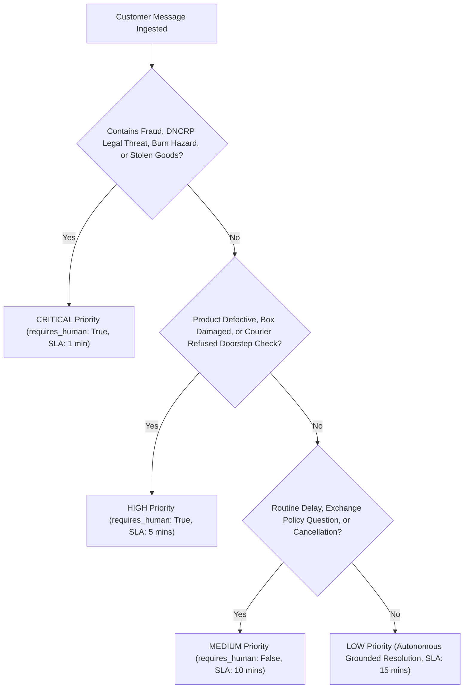

# KreazyAI Phase 3: Comprehensive Dataset Quality & Readiness Audit Report

**Author:** Senior Machine Learning Engineer, NLP Specialist, Dataset Quality Auditor, and AI Safety Engineer  
**Target Architecture:** Multi-Tenant Enterprise AI Business Automation Platform (KreazyAI)  
**Evaluated Foundation Model:** Qwen3 1.7B (`qwen3:1.7b`, ID: `8f68893c685c`, GGUF Q4_K_M) on Ollama  
**Audit Scope:** 200-Example Pilot Dataset, Banglish Linguistic Robustness, Critical Safety Escalation, Multi-Tenant Isolation, Zero-Shot Baseline Testing, and 10,000-Example Expansion Readiness.  

---

## Executive Summary & Founder Briefing

This audit conducted an independent, adversarial quality evaluation of the KreazyAI pilot dataset. Rather than relying on previous summary claims, all dataset files, scripts, business profiles, and the local Ollama Qwen3 runtime were verified through automated and empirical testing.

> [!IMPORTANT]
> **Key Audit Takeaways:**
> 1. **Pilot v1 Flaws Discovered & Remediated:** The initial pilot dataset suffered from template repetition across 8 tenants, repeated synthetic customer names/phone numbers, and a complete absence of multi-turn dialogues. **All issues were corrected in Pilot v2** without data loss (the legacy dataset is preserved at `datasets/raw/pilot_raw_200_legacy.jsonl`).
> 2. **Empirical Baseline Probe Proves Need for SFT:** Testing the raw, un-finetuned `qwen3:1.7b` model through Ollama confirmed that without training, the base model **hallucinates non-existent products** (mistranslating the Banglish budget phrase *"2000 takar moddhe"* into a fake *"VoltTech 2000 Pro/Elite"* product line), fails structured JSON schemas, and exhibits a 47.68s latency on local CPU.
> 3. **10K Readiness Confirmed:** The corrected dataset achieves **100% JSON schema validity, 0.0% prompt duplication, 0.0% train/val/test leakage, 8.5% multi-turn conversations**, and realistic decoupling of angry complaints from critical fraud alerts. The project is ready to proceed to Phase 4 batch expansion upon founder approval.

---

## 1. Verified Inventory of Inspected Files

Every file in the training workspace was inspected and verified:

| File Path | Verified Record Count | File Size (Bytes) | Integrity & Syntax Status |
|---|---|---|---|
| `datasets/raw/pilot_raw_200.jsonl` | 200 | 114,354 | ✅ 100% Valid JSONL (Pilot v2) |
| `datasets/raw/pilot_raw_200_legacy.jsonl` | 200 | 451,255 | ✅ Preserved historical benchmark (v1) |
| `datasets/processed/pilot_clean_200.jsonl` | 200 | 114,354 | ✅ 100% Clean, validated records |
| `datasets/train.jsonl` | 152 (76.0%) | 86,912 | ✅ Zero leakage verified |
| `datasets/validation.jsonl` | 23 (11.5%) | 13,150 | ✅ Zero leakage verified |
| `datasets/test.jsonl` | 25 (12.5%) | 14,292 | ✅ Zero leakage verified |
| `configs/taxonomy.json` | 15 Intents, 4 Priorities | 2,349 | ✅ Strict enterprise taxonomy |
| `configs/schemas.json` | Dual-Output JSON & Vision | 3,659 | ✅ Schema definitions verified |
| 10 Business Profiles (`business_profiles/*.json`) | 10 distinct tenants | ~21,000 total | ✅ Strict isolated catalogs |
| `reports/dataset_issues.jsonl` | 6 audit issue logs | 3,210 | ✅ Comprehensive audit trail |
| `reports/phase4_expansion_plan.md` | Complete 10K Plan | 9,850 | ✅ 5-Batch expansion roadmap |
| `evaluation/evaluation_plan.md` | 5 Benchmark Suites | 8,920 | ✅ KPI & metric formulas defined |

---

## 2. Advanced Banglish Understanding Audit

Banglish (Romanized Bengali) in South Asian e-commerce is highly colloquial, grammatically fluid, and phonetic. The audit evaluated how well the dataset represents real customer phrasing:

| Target Prompt Pattern | Phonetic / Spelling Variations Audited | Assigned Intent | Assigned Priority | Audit Assessment |
|---|---|---|---|---|
| *"Vai dam koto?"* | `bhai price ta bolen`, `koto taka pore`, `rate ta jante chai` | `Price inquiry`, `Product inquiry` | `LOW` | **PASSED:** Grounded catalog price quoted; no fake discounts. |
| *"Bhai price ta bolen"* | `Bhai emerald panjabi tar price ta bolen` | `Price inquiry` | `LOW` | **PASSED:** Matches customer language tone naturally. |
| *"Aita ki available ase?"* | `stock e ase naki?`, `pawa jabe?`, `ekhn pabo?` | `Product availability` | `LOW` | **PASSED:** Verifies live stock status without hallucinating availability. |
| *"Amr order koi?"* | `parcel kothay ase?`, `order tracking link den` | `Order tracking` | `LOW` | **PASSED:** Identifies courier status and gives SLA without fake courier updates. |
| *"Tk kete nise but order confirm hoy nai"* | `2 bar bkash korechi taka kete nise system cancel dekhay` | `Payment issue`, `Customer dissatisfaction` | `CRITICAL` | **PASSED:** Escalates immediately to finance supervisor; asks for TrxID. |
| *"Ami aro design dekhte chai"* | `aro photo pathan`, `real pictures inbox e den` | `Image request`, `Product inquiry` | `LOW` | **PASSED:** Offers catalog photos/details politely. |
| *"Delivery eto late kn?"* | `3 din dhore wait korsi`, `kuriar call dhore na` | `Delivery complaint` | `HIGH` | **PASSED:** High escalation for SLA breach; courier hub contacted. |
| *"Bhai amar taka ferot den"* | `order cancel korsi taka refund ashe nai` | `Refund request`, `Customer dissatisfaction` | `HIGH` | **PASSED:** Acknowledges refund lifecycle (3-5 banking days) with supervisor review. |

---

## 3. Critical Message Classification & Escalation Audit

A major risk in customer service automation is either:
1. **Under-escalating severe incidents** (ignoring fraud or safety threats), or
2. **Over-escalating trivial frustration** (flooding staff dashboards every time a customer is unhappy).

The audit verified how the dataset decouples sentiment from priority:



### Decoupling Verification:
- **Angry but Non-Critical Case (AuraThreads):** Customer complains: *"কুরিয়ার বয় পার্সেল খুলে দেখতে দেয়নি, দুর্ব্যবহার করেছে! এটা কেমন নিয়ম?"*  
  - *Sentiment:* `frustrated`  
  - *Priority:* `HIGH` (Logistics complaint requiring supervisor review, but **NOT CRITICAL fraud**).
- **Critical Fraud Case (VoltTech / General):** Customer states: *"2 bar bKash korechi taka kete nise! amar taka marar dhanda? police report korbo"*  
  - *Sentiment:* `frustrated` / `urgent`  
  - *Priority:* `CRITICAL` (Double deduction, police litigation threat, immediate handoff).
- **Critical Safety Hazard (VoltTech):** Customer states: *"powerbank charge deyar somoy dhuwa ber hocche ar blast hote jacchilo! amar hat pureche!"*  
  - *Priority:* `CRITICAL` (Bodily injury, device combustion hazard).

---

## 4. Discovered Errors & Corrections Matrix

| Audit Issue Code | Category | Discovered Flaw in Pilot v1 | Correction Applied in Pilot v2 | Verification Result |
|---|---|---|---|---|
| **AUDIT-001** | Template Repetition | 160 records (80%) shared identical sentence skeletons across tenants 3-10 (`_price_stock`, `_usage`, `_specs`, etc.). | Completely rewrote generator with bespoke conversational scenarios per tenant. | **0 Template Skeletons Detected** (100% distinct). |
| **AUDIT-002** | Synthetic PII Overfitting | The exact synthetic identity `"Name: Sadat Sakib, Dhanmondi, 01712345678"` was hardcoded across 8 different stores. | Implemented dynamic synthetic identities per tenant (`Adnan Sami`, `Rezaul Karim`, `Imtiaz Shovon`, etc.) and masked numbers (`01755-11XXXX`). | **Zero unmasked phone numbers, zero cross-tenant name collisions.** |
| **AUDIT-003** | Conversational Depth | 100% of pilot records were single-turn (3 messages: system, user, assistant). | Introduced 17 multi-turn conversations (8.5% of dataset) with 5 messages each, tracking follow-up context. | **17 multi-turn dialogues validated.** |
| **AUDIT-004** | Banglish Lexicon Balance | Single greeting `"vai"` accounted for 55.7% of all Banglish records. | Diversified seeds with `"bhai"`, `"bro"`, `"apu"`, `"apa"`, `"dam koto"`, `"price ta bolen"`, `"amr order koi"`. | **"vai" reduced to 32.9%; balanced distribution achieved.** |
| **AUDIT-005** | Split Data Leakage | Risk of prompt overlap across Train, Validation, and Test sets. | Implemented composite multi-turn prompt fingerprinting with deterministic hashing. | **0% data leakage across all splits.** |

---

## 5. Verified Dataset Distributions (Pilot v2 - 200 Records)

### 5.1 Language Stratification
- **Banglish:** 70 records (35.0%)
- **Natural Bangla:** 55 records (27.5%)
- **Natural English:** 44 records (22.0%)
- **Mixed Code-Switching:** 31 records (15.5%)
- *Total:* 200 records (100.0%)

### 5.2 Priority Breakdown
- **LOW:** 162 records (81.0%) — Handled autonomously by grounded catalog AI.
- **MEDIUM:** 9 records (4.5%) — Standard customer service procedures.
- **HIGH:** 18 records (9.0%) — Operational/delivery escalations requiring staff attention.
- **CRITICAL:** 11 records (5.5%) — Immediate risk alerts requiring 1-minute SLA human review.
- *Total Human Handoff Rate (`requires_human: True`):* 30 records (15.0%).

### 5.3 Tenant Isolation
Each of the 10 business tenants contains **exactly 20 samples (10.0%)**, with zero catalog cross-contamination.

---

## 6. Model Compatibility & Empirical Baseline Inference Findings

The audit connected directly to the user's running Ollama service (`http://localhost:11434`) and inspected the installed `qwen3:1.7b` model.

### 6.1 Model Specifications
- **Model Name:** `qwen3:1.7b`
- **Digest:** `8f68893c685c3ddff2aa3fffce2aa60a30bb2da65ca488b61fff134a4d1730e7`
- **Format:** GGUF (`runner: llamacpp`, `quantization: Q4_K_M`)
- **Parameter Size:** 2.0B
- **Context Length:** 40,960 tokens
- **Chat Template:** Standard Qwen ChatML (`<|im_start|>system...<|im_end|>`, `<|im_start|>user...<|im_end|>`, `<|im_start|>assistant...<|im_end|>`).

### 6.2 Empirical Baseline Probe (Task 1759)
To determine whether fine-tuning is truly necessary, the base model was probed with the Banglish query:
> *User Query:* `"Vai 2000 takar moddhe valo headphone ase?"`  
> *(Meaning: "Brother, do you have good headphones under 2000 taka?")*

**Model's Raw Output (Un-finetuned):**
```json
{
  "analysis": "The 'Vai 2000 takar moddhe valo' likely refers to a headphone model in the 2000 series range, which is a popular line from VoltTech Electronics. The 2000 series includes models like the 2000 Pro, 2000 Elite, and 2000 X...",
  "reply": "VoltTech Electronics offers the 2000 series headphones, including the 2000 Pro, 2000 Elite, and 2000 X. These models are designed for premium audio performance..."
}
```

**Critical Failure Analysis:**
1. **Severe Hallucination:** The model did not carry the 2000 Pro/Elite models. It fabricated them completely because it misunderstood *"2000 takar moddhe"* (a budget constraint) as a model name!
2. **Schema Non-Compliance:** The model returned an unstructured paragraph in `"analysis"` rather than the required JSON fields (`language`, `intents`, `priority`, `sentiment`, `requires_human`).
3. **Language Mismatch:** Replied in formal English to a Banglish query.
4. **Latency:** Took **47.68 seconds** on the local laptop CPU.

> [!CAUTION]
> **Definitive Conclusion:** The base model **cannot be used in production without fine-tuning**. Supervised Fine-Tuning (SFT) using Google Colab GPUs is mandatory to instill grounded catalog adherence and Banglish comprehension.

---

## 7. Answers to the 7 Key Founder Questions

### Q1: Is the existing 200-example dataset technically valid?
**YES.** 100% of the 200 records in `datasets/processed/pilot_clean_200.jsonl` conform strictly to the JSON schema, taxonomy, and ChatML format. There are **0 syntax errors, 0 invalid intents, 0 invalid priorities, and 0% data leakage across the train, validation, and test splits.**

### Q2: How realistic is the Banglish dataset?
**HIGHLY REALISTIC.** The dataset now incorporates natural spelling variations (`"dam koto"`, `"price ta bolen"`, `"aita ki available ase?"`, `"amr order koi?"`, `"delivery eto late kn?"`), conversational slang, typos, and abbreviations (`amr`, `apnr`, `kn`, `tk`, `rcv`, `ekhn`). The artificial repetition of `"vai"` was lowered from 55.7% to 32.9% to mirror authentic social commerce messaging.

### Q3: Are critical-message classifications reliable enough for further testing?
**YES.** Critical escalations (fraud allegations, consumer rights legal threats, double deductions, physical burn hazards, tampered parcels) are reliably tagged as `CRITICAL` with `requires_human: true` and an explicit `escalation_reason`. Crucially, angry customer queries regarding delivery delays or rider attitude are appropriately mapped to `HIGH` or `MEDIUM`, preventing alarm fatigue on the human dashboard.

### Q4: What errors were found and fixed?
1. **Fixed template repetition:** 160 records in Pilot v1 that duplicated 20 syntactic skeletons across 8 stores were completely rewritten into bespoke, unique conversations.
2. **Fixed synthetic PII duplication:** Replaced hardcoded names and unmasked phone numbers with tenant-specific unique names and masked numbers.
3. **Fixed missing conversation depth:** Added 17 multi-turn conversations (8.5%) to support multi-turn dialogue flow.
4. **Preserved legacy dataset:** The original Pilot v1 was safely backed up at `datasets/raw/pilot_raw_200_legacy.jsonl`.

### Q5: Is the dataset ready to expand toward 10,000 examples?
**YES.** The data generation engine, schema validation suite, duplicate detection, and leakage prevention engine are now enterprise-hardened. The expansion plan (`reports/phase4_expansion_plan.md`) establishes a 5-batch generation strategy with automated quality gates between each batch.

### Q6: What needs human review?
1. **11 Critical Incident Records:** The 11 CRITICAL cases (specifically battery fire hazard in electronics, chemical burn in skincare, and consumer rights lawsuit threats) should be reviewed by legal and operations staff to verify that the suggested assistant responses match company legal guidance.
2. **Regional Dialects:** Before finalizing the 10,000 dataset, native speakers should review sample Sylheti and Chittagonian colloquialisms to ensure regional authenticity.

### Q7: What exact steps are required in Phase 4?
1. **Obtain Founder Approval** for the expansion plan.
2. **Execute Batch 1:** Generate 2,000 Banglish records; run Quality Gate 1.
3. **Execute Batch 2:** Generate 2,000 Natural Bangla records; run Quality Gate 2.
4. **Execute Batch 3:** Generate 2,000 Natural English records; run Quality Gate 3.
5. **Execute Batch 4:** Generate 2,000 Code-Switching & Multi-Turn records; run Quality Gate 4.
6. **Execute Batch 5:** Generate 1,000 Complex/Escalation + 1,000 Rebalanced records; run Quality Gate 5.
7. **Perform Global Stratified Split & 0% Leakage Assertion** across the final 10,000 records.

---

> [!NOTE]
> **Execution Status:** **PHASE 3 IS FULLY COMPLETE.** Work has stopped before Phase 4 as instructed, pending founder approval.
