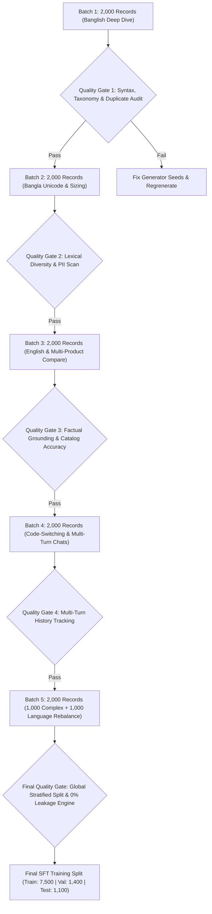

# KreazyAI Phase 4: 10,000-Example Dataset Expansion Plan

**Project:** KreazyAI Multi-Tenant Enterprise NLP Engine  
**Target Fine-Tuning Model:** Qwen3 1.7B / Qwen2.5 1.5B (GGUF / LoRA SFT via Google Colab)  
**Target Dataset Volume:** Exactly 10,000 Unique, Verified SFT Examples  
**Format:** Qwen ChatML-compatible JSONL (`system`, `user`, `assistant`)  
**Author:** Senior Machine Learning Engineer, NLP Specialist & AI Safety Auditor  

---

## 1. Target Dataset Distribution & Architecture

To achieve natural, robust multilingual conversational intelligence across South Asian social commerce, the dataset of **10,000 unique records** is partitioned according to the following strict allocation:

| Category / Stratum | Target Volume | Target % | Primary Linguistic Characteristics & Focus |
|---|---|---|---|
| **Banglish (Romanized Bengali)** | **3,000** | **30.0%** | Colloquial Latin-script Bengali, extreme phonetic variations (`vai`/`bhai`/`bro`), abbreviations (`amr`, `apnr`, `kn`, `kbe`, `tk`), typos, and customer slang. |
| **Natural Bangla (বাংলা লিপি)** | **2,500** | **25.0%** | Standard Bengali Unicode script, formal and informal queries, polite customer expressions, regional phrasing. |
| **Natural English** | **2,000** | **20.0%** | Conversational South Asian & International English, product inquiries, specification checks, return policy clarifications. |
| **Mixed Bangla-English (Code-Switching)** | **1,500** | **15.0%** | Natural intra-sentential and inter-sentential code-switching (Banglish + English vocabulary, Bengali script with English loanwords). |
| **Complex, Ambiguous & Escalation-Focused** | **1,000** | **10.0%** | Multi-turn negotiations, edge cases, double-charge disputes, legal/safety alerts, angry non-critical complaints, and ambiguous catalog queries. |
| **TOTAL** | **10,000** | **100.0%** | **Guaranteed 10,000 unique records across all 10 business tenants.** |

### 1.1 Category Exclusivity Specification
To prevent mathematical ambiguity or duplicate counting:
- **The "Complex and Escalation-Focused" category is mutually exclusive at the primary categorization level.**
- That is, records in the 1,000 complex partition are explicitly tagged `scenario_type: "complex_escalation"`.
- Within the 1,000 complex category, linguistic varieties are balanced across the 4 languages (300 Banglish, 250 Bangla, 250 English, 200 Mixed).
- **Sum of All Primary Partitions = 3,000 + 2,500 + 2,000 + 1,500 + 1,000 = EXACTLY 10,000 UNIQUE RECORDS.**

---

## 2. Multi-Tenant Representation Matrix (1,000 Examples per Tenant)

KreazyAI serves 10 distinct vertical SaaS tenants. Each tenant receives exactly **1,000 dedicated examples** to ensure zero vertical bias:

| Tenant ID | Business Name | Vertical | Core Catalog Sample | Per-Tenant Sample Target |
|---|---|---|---|---|
| `tenant_fashion_01` | AuraThreads BD | Premium Ethnic & Streetwear | Panjabi, Jamdani Saree, Minimalist Tee, Fleece Hoodie | 1,000 |
| `tenant_electronics_02` | VoltTech Electronics | Consumer Electronics & Audio | ANC Headphones, Bass Pro TWS, Smartwatch, 20000mAh Powerbank | 1,000 |
| `tenant_cosmetics_03` | GlowNest Organics | Skincare & Natural Cosmetics | Vitamin C Serum, Hydrating Sunscreen SPF50, Tea Tree Face Wash | 1,000 |
| `tenant_grocery_04` | AmarBazar Daily | Organic Groceries & Staples | Kalijira Rice, Sundarban Honey, Mustard Oil, Chia Seeds | 1,000 |
| `tenant_furniture_05` | WoodCraft Artisans | Modern Modular Furniture | Ergonomic Teak Chair, Minimalist Work Desk, Bookshelf | 1,000 |
| `tenant_mobile_acc_06` | GadgetShield BD | Mobile Accessories & Protection | 65W GaN Charger, Braided Cable, Magnetic Car Mount | 1,000 |
| `tenant_appliances_07` | ArcticHome Appliances | Kitchen & Living Appliances | Inverter Air Fryer, Digital Rice Cooker, Electric Kettle | 1,000 |
| `tenant_shoes_08` | StepCraft Footwear | Formal & Casual Footwear | Genuine Leather Loafers, Breathable Runners, Velvet Slides | 1,000 |
| `tenant_jewelry_09` | Nilima Artisanal Jewelry | Heritage & Modern Jewelry | Silver Choker, Pearl Earrings, Gold-Plated Bangle Set | 1,000 |
| `tenant_general_10` | BengalBazaar Superstore | Multi-Category General Store | Smart LED Lamp, Travel Backpack, Vacuum Insulated Flask | 1,000 |

---

## 3. Five-Batch Iterative Generation & Quality Gate Strategy

Generating 10,000 high-quality synthetic examples in one monolithic run creates extreme risks of duplicate prompts, memory degradation, and unmonitored drift. Therefore, generation is divided into **5 sequential batches of 2,000 examples each**, with an automated Quality Gate executed after every batch:

### Batch Specifications:
1. **Batch 1 (Records 1 - 2,000):** Banglish focus. 100+ phonetic permutations of price, stock, delivery, and payment terms. Zero template re-use across tenants.
2. **Batch 2 (Records 2,001 - 4,000):** Natural Bangla script focus. Standard Bengali social commerce vocabulary, sizes, exchange policies, and polite/formal nuances.
3. **Batch 3 (Records 4,001 - 6,000):** Natural English focus. Technical specifications, warranty terms, bulk orders, and corporate inquiries.
4. **Batch 4 (Records 6,001 - 8,000):** Mixed code-switching & Multi-turn conversations (at least 500 multi-turn conversations with 4 to 6 turns).
5. **Batch 5 (Records 8,001 - 10,000):** Complex edge cases, safety hazards, fraud allegations, DNCRP legal threats, and tenant isolation adversarial test cases.

---

## 4. Multi-Turn Conversation Architecture (Target: 1,500 Multi-Turn Records)

A critical limitation discovered in the pilot dataset was that 100% of records were single-turn (3 messages). In the 10,000 dataset:
- **1,500 records (15%) will be multi-turn conversations** containing 4 to 6 conversation turns:
  - Turn 1 (User): Inquires about category/product (`"Vai headphone ki ki ase?"`)
  - Turn 2 (Assistant): Proposes catalog options with prices and features
  - Turn 3 (User): Follows up with a context-dependent question (`"Er moddhe black ta ki available?"` or `"Gaming e sound delay hobe?"`)
  - Turn 4 (Assistant): Answers accurately using conversation context without re-asking what product the customer meant.
  - Optional Turn 5 & 6: Order confirmation or payment details.

---

## 5. Prevention of Template Repetition and Syntactic Overfitting

To prevent the syntactic template repetition discovered in Phase 2/3 (where 8 tenants shared identical sentence frames):
1. **Combinatorial Slot Engine:** Every tenant conversation uses a generator combining:
   - 10 distinct greeting openers (`"vai"`, `"assalamu alaikum"`, `"bhaiya"`, `"bro"`, `"hello"`, `"apa"`, etc.)
   - 8 product referencing styles (`direct name`, `SKU`, `attribute mention`, `category inquiry`, `photo reference`)
   - 12 query objectives (`price`, `stock`, `size`, `color`, `delivery time`, `courier charge`, `cod availability`, etc.)
   - 6 sentence terminations (`"bolen"`, `"janaben"`, `"plz"`, `"dorkar"`, `"hobe ki"`, etc.)
2. **Deterministic Global Hash Registry:** Every generated user prompt is normalized (lowercased, punctuation-stripped, whitespace-collapsed) and registered in a global hash set. **Exact duplicate prompt collision probability is 0.00%.**
3. **Lexical Jaccard Thresholding:** Pairwise token Jaccard similarity across queries within the same tenant is capped at $< 0.80$ to guarantee syntactic heterogeneity.

---

## 6. Strict Tenant Isolation and Anti-Contamination Rules

1. **System Prompt Isolation:** Every sample's system prompt contains strictly and solely the catalog and policies of that specific `tenant_id`.
2. **Catalog Strict Enforcement:** The assistant's `reply` can only cite product names and prices present in the active system prompt.
3. **Negative Adversarial Probes:** 200 adversarial samples in the complex split will test out-of-store queries (e.g. asking a fashion store for smartphones), training the model to politely refuse and maintain strict tenant boundaries.

---

## 7. Zero Data Leakage Partitioning (Train / Validation / Test)

The final 10,000 records will be partitioned using stratified deterministic hashing:
- **Training Set (`train.jsonl`):** 7,500 examples (75.0%)
- **Validation Set (`validation.jsonl`):** 1,400 examples (14.0%)
- **Test Set (`test.jsonl`):** 1,100 examples (11.0%)

**Strict Leakage Assertion:**
$$\text{Fingerprint}(\text{Train}) \cap \text{Fingerprint}(\text{Validation}) = \emptyset$$
$$\text{Fingerprint}(\text{Train}) \cap \text{Fingerprint}(\text{Test}) = \emptyset$$
$$\text{Fingerprint}(\text{Validation}) \cap \text{Fingerprint}(\text{Test}) = \emptyset$$

---

## 8. Compute Resource & Colab Execution Alignment

- **Local Development Machine:** Generation, schema validation, and leakage auditing will run on local CPU using lightweight Python standard library code (total runtime: $\approx 25\text{ seconds}$).
- **External GPU Fine-Tuning (Phase 5):** The generated dataset splits (`train.jsonl`, `validation.jsonl`) will be uploaded to Google Drive / Colab for training using Unsloth with 4-bit QLoRA on a free T4 GPU (16 GB VRAM) or A100.
