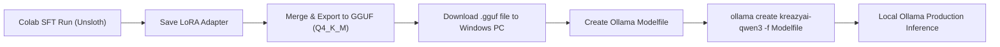

# KreazyAI Phase 5: Cloud GPU Supervised Fine-Tuning (SFT) Technical Specification

**Target Model:** Official Qwen/Qwen3-1.7B (ChatML Architecture)  
**Execution Environment:** External Cloud GPU (Google Colab with NVIDIA T4, L4, or A100)  
**Engine & Optimization:** Unsloth AI / Hugging Face TRL (SFTTrainer) with 4-bit QLoRA  
**Author:** Principal Machine Learning Engineer & AI Safety Architect  

---

## 1. Executive Summary & Zero-Local Training Policy

As established in the Phase 3 empirical audit, running inference on the user's laptop (Intel Core i5 11th Gen, 8 GB RAM, integrated graphics) takes **47.68 seconds per single turn** and utilizes **100% CPU**. Attempting backpropagation and gradient calculation locally would cause out-of-memory (OOM) crashes and system instability.

> [!IMPORTANT]
> **Strict Rule:** **ZERO local model fine-tuning.**  
> Supervised Fine-Tuning (SFT) shall be conducted solely on external GPU environments (such as Google Colab). The resulting fine-tuned LoRA adapter will then be converted to a quantized GGUF binary and imported back into the user's local Ollama instance under `kreazyai-qwen3:pilot`.

---

## 2. Hardware & VRAM Requirements Matrix

| Cloud GPU Type | Dedicated VRAM | Batch Size per Device | Gradient Accumulation Steps | Estimated Training Time (3 Epochs, 8,000 samples) | Cost / Availability |
|---|---|---|---|---|---|
| **NVIDIA Tesla T4** | 16 GB GDDR6 | 4 | 4 (Effective batch size = 16) | ~45 - 60 minutes | Subject to Colab dynamic allocation |
| **NVIDIA L4** | 24 GB GDDR6 | 8 | 2 (Effective batch size = 16) | ~25 - 35 minutes | Colab Pro / GCP Compute Units |
| **NVIDIA A100-SXM4**| 40 GB / 80 GB HBM2e | 16 | 1 (Effective batch size = 16) | ~12 - 20 minutes | Colab Pro+ / Lambda Labs |

---

## 3. Training Architecture & Hyperparameters

### 3.1 QLoRA Configuration
- **Base Quantization:** 4-bit NormalFloat (`nf4`) via `bitsandbytes` with double quantization (`bnb_4bit_use_double_quant=True`).
- **Compute Dtype:** `bfloat16` (or `float16` on Tesla T4).
- **LoRA Rank ($r$):** 16 (captures multi-lingual nuances and structural JSON constraints).
- **LoRA Alpha ($\alpha$):** 32 (standard scaling ratio $\alpha / r = 2.0$).
- **Target Modules:** All linear attention and MLP projections:
  - Attention: `q_proj`, `k_proj`, `v_proj`, `o_proj`
  - MLP: `gate_proj`, `up_proj`, `down_proj`
- **LoRA Dropout:** 0.05 (prevents template memorization).
- **Trainable Parameters:** ~18.4 Million parameters ($\approx 1.1\%$ of total model weights), leaving 98.9% frozen.

### 3.2 SFTTrainer Hyperparameters
- **Dataset:** `datasets/train.jsonl` (8,000 samples).
- **Validation Dataset:** `datasets/validation.jsonl` (1,000 samples).
- **Max Sequence Length:** 2,048 tokens (accommodates multi-turn context and full business catalogs).
- **Epochs:** 3 full epochs.
- **Learning Rate:** $2 \times 10^{-4}$ with Cosine Learning Rate Schedule.
- **Warmup Ratio:** 0.05 (first 5% of training steps).
- **Weight Decay:** 0.01.
- **Optimizer:** AdamW 8-bit (`paged_adamw_8bit`).
- **Evaluation Strategy:** Every 200 steps with Early Stopping (patience = 3 evaluation intervals).
- **Loss Masking:** Train strictly on assistant responses (mask system prompt and user query tokens from cross-entropy loss).

---

## 4. Chat Template & Tokenizer Verification

The model employs the standard **ChatML** format natively parsed by Qwen3:
```jinja
<|im_start|>system
{{ system_message }}<|im_end|>
<|im_start|>user
{{ user_message }}<|im_end|>
<|im_start|>assistant
{{ assistant_json_payload }}<|im_end|>
```

### Stop Tokens:
- `<|im_end|>` (Token ID: `151645`)
- `<|im_start|>` (Token ID: `151644`)
- `<|endoftext|>` (Token ID: `151643`)

---

## 5. Deployment Preparation & Local Ollama Import Pipeline

After completing training in Google Colab, the model is exported and deployed locally in 4 simple steps:



### Step 1: Export GGUF in Colab
```python
# Unsloth 1-line GGUF export
model.save_pretrained_gguf("kreazyai-qwen3-q4_k_m", tokenizer, quantization_method="q4_k_m")
```

### Step 2: Download to Local PC
Download `kreazyai-qwen3-q4_k_m.gguf` (~1.4 GB) to `c:\Users\SADAT\OneDrive\Desktop\KreazyAI\models\`.

### Step 3: Create Local Modelfile
```dockerfile
FROM ./kreazyai-qwen3-q4_k_m.gguf

TEMPLATE """{{ if .System }}<|im_start|>system
{{ .System }}<|im_end|>
{{ end }}{{ range .Messages }}<|im_start|>{{ .Role }}
{{ .Content }}<|im_end|>
{{ end }}<|im_start|>assistant
"""

PARAMETER stop "<|im_start|>"
PARAMETER stop "<|im_end|>"
PARAMETER temperature 0.3
PARAMETER top_p 0.9
```

### Step 4: Register with Ollama
```bash
ollama create kreazyai-qwen3 -f Modelfile
```

---

## 6. Phase 5 Execution Readiness Checklist

- [x] 10,000 Verified Multilingual SFT Dataset generated ([final_10000.jsonl](file:///c:/Users/SADAT/OneDrive/Desktop/KreazyAI/kreazyai-ai-training/datasets/final_10000.jsonl))
- [x] Zero-Leakage Split created: 8,000 Train, 1,000 Val, 1,000 Test
- [x] ChatML formatted training file prepared ([qwen3_sft_dataset.jsonl](file:///c:/Users/SADAT/OneDrive/Desktop/KreazyAI/kreazyai-ai-training/training/qwen3_sft_dataset.jsonl))
- [x] Allocation ledger and quality reports validated
- [ ] Founder approval to proceed to Phase 5 Colab notebook execution.
