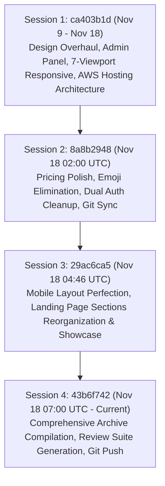

# KreazyAI Project Engineering & Design Sessions Summary

> **Review Period:** November 9, 2026 – November 18, 2026  
> **Repository:** [sadat87/Kreazyai](https://github.com/sadat87/Kreazyai)  
> **Total Conversation Sessions:** 4 Major Interactive Sessions  
> **Total Turns Documented:** 59+ User & Agent Turns  
> **Total Git Commits Produced:** 18+ Production Commits  

---

## 1. Executive Timeline of Development Sessions

---

## 2. Session Summaries & Key Deliverables

### Session 1: `ca403b1d-21e6-464c-bdf8-3a59a755f704`
- **Scope:** 38 User Turns over 9 days.
- **Key Milestones:**
  1. Complete website Dark Obsidian theme overhaul inspired by ElevenLabs aesthetic.
  2. Navbar reorganization into a clean 4-item pill capsule (`Pricing`, `Blog`, `Solutions`, `Integrations`).
  3. Transformation of all bubbly/curvy buttons and cards into crisp, geometric rectangular boxes.
  4. Integration of the official brand logo lockup: white "KREAZY", yellow "AI" on black background.
  5. Decoupling port 5174 from the admin portal to serve the live website on both standard ports.
  6. Creation of the dedicated `aibootcampwithsadat` career masterclass landing page and intake flow.
  7. Development of the comprehensive `backend_admin_architecture.md` manual.
  8. Full infrastructure breakdown identifying Cloudflare DNS, AWS Amplify / CloudFront + S3 static hosting, Render Node.js REST API, and Neon PostgreSQL database.
- **Full Transcript:** [`reviewing/conversations/01_MAIN_WEBSITE_UI_UX_AND_ARCHITECTURE.md`](file:///c:/Users/SADAT/OneDrive/Desktop/KreazyAI/reviewing/conversations/01_MAIN_WEBSITE_UI_UX_AND_ARCHITECTURE.md)

---

### Session 2: `8a8b2948-b7dc-4998-abd7-4d2db2d1c714`
- **Scope:** 6 User Turns.
- **Key Milestones:**
  1. Hero section pricing box refinement: removed flickering backgrounds and intrusive decorative pills.
  2. Restyled all pricing digits with clean high-contrast cyan/blue accents (`#38bdf8`).
  3. Eliminated all emojis across authentication pages and forms for professional enterprise standards.
  4. Streamlined Google Connect button into a native single-click experience.
  5. Cleaned up unused imports and resolved JavaScript warnings.
- **Full Transcript:** [`reviewing/conversations/03_PRICING_AND_AUTH_CLEANUP.md`](file:///c:/Users/SADAT/OneDrive/Desktop/KreazyAI/reviewing/conversations/03_PRICING_AND_AUTH_CLEANUP.md)

---

### Session 3: `29ac6ca5-3600-4e48-a36f-79b80542ecfd`
- **Scope:** 15 User Turns.
- **Key Milestones:**
  1. Detailed mobile responsive fixes across landing page sections.
  2. Replaced markup overlays with photorealistic founder visual on `/login` and social commerce dual-iPhone showcase on `/signup`.
  3. Replaced hero metric cards with live interactive pricing blocks.
  4. Removed "Live meta automation" and "Live Performance Telemetry" text clutter per user feedback.
  5. Implemented mobile-only hiding of showcase images on `/login` and `/signup` so mobile users access form inputs instantly.
  6. Verified zero horizontal overflow (`scrollWidth === innerWidth === 390px`).
- **Full Transcript:** [`reviewing/conversations/02_MOBILE_VIEW_PERFECTION_AND_SHOWCASE.md`](file:///c:/Users/SADAT/OneDrive/Desktop/KreazyAI/reviewing/conversations/02_MOBILE_VIEW_PERFECTION_AND_SHOWCASE.md)

---

### Session 4: Current Session
- **Scope:** Review packet compilation and synchronization.
- **Key Milestones:**
  1. Extracted and structured all past conversation transcripts into human-readable Markdown and machine-readable JSON.
  2. Archived all architectural whitepapers, mobile layout reports, and hosting documentation into `reviewing/`.
  3. Committed and pushed the entire review suite to the GitHub repository.

---

## 3. Git Commit Lineage

| Commit Hash | Description |
| :--- | :--- |
| `06e661f` | `fix(deployment): add amplify build spec, SPA rewrites, fallback 404 handler, and restore hero benefit pills` |
| `d59be60` | `feat(pricing): show actual prices by default and apply discount conditionally on claim` |
| `e95ccf5` | `fix(auth): remove marked-up elements, eliminate emojis, and update Google connect button` |
| `4d74171` | `fix(auth): update Google sign-in label in LoginPage` |
| `3146120` | `fix(auth): clean unused imports in GoogleVerificationModal` |
| `2d1b85e` | `feat: mobile layout optimization, landing page sections reorganization, and auth showcase overhaul` |
| `f7bcdcc` | `feat(responsive): comprehensive mobile-first design system and legal center overhaul across all 7 viewports` |
| `f925599` | `fix(branding): enforce cache-busting versioned brand logo across website, auth, and admin portal` |
| `468d94b` | `feat(mobile): add full Expo React Native mobile application for KreazyAI` |
| `6712da1` | `feat(ui): enforce crisp rectangular boxes and buttons across entire website and admin portal` |
| `c33a819` | `fix(mobile): prevent decorative background rings from overflowing auth views on mobile` |
| `8241493` | `fix(routing): decouple admin portal from port 5174 so localhost:5174 serves the live website` |
| `f8cd859` | `feat(branding): implement exact picture logo lockup across entire website with white KREAZY and yellow AI on black background` |
| `c272a06` | `feat(header): update header logo to use official logo lockup from uploaded image` |
| `d76fded` | `feat(hero): replace metric card with animated pricing boxes and remove hero bootcamp pill` |
| `58fb348` | `fix(auth): enable universal super-admin credentials and self-healing login across PostgreSQL and SQLite` |
| `8fc07f4` | `feat(ui): eliminate all emojis across entire application and streamline copy for clean minimalist readability` |
| `0de0854` | `feat(pdf): generate 10-page master multi-sector SaaS value and economic ROI whitepaper` |
| `0d02943` | `feat(admin): elevate admin panel to ElevenLabs standard with live telemetry, mobile bottom nav, and backend architecture documentation` |
